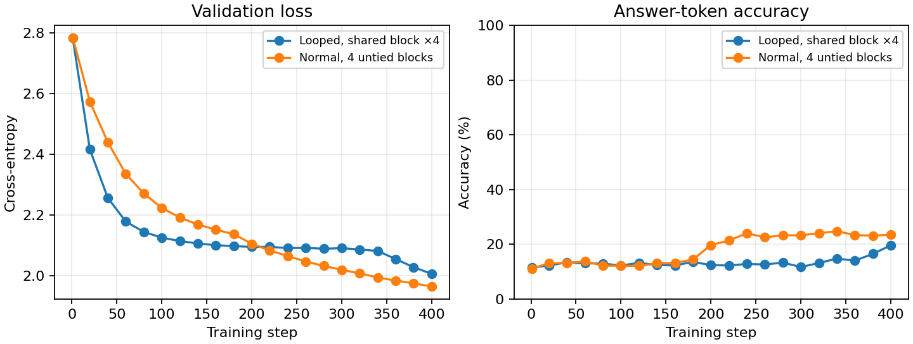
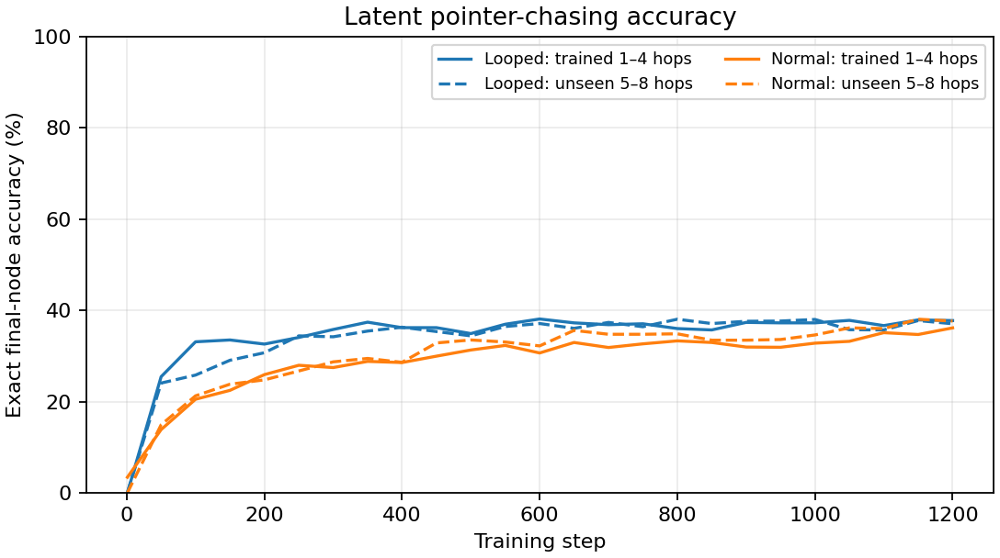

# Looped language model, from scratch

A compact PyTorch project for learning how **recurrent-depth (looped) language
models** work and for testing their behavior against a conventional
Transformer. It is an educational implementation, not a pretrained or
production-ready LLM.

## What a looped language model is

A normal Transformer stores a different block at each depth. This project’s
looped model stores one causal Transformer block and applies it repeatedly:

```text
tokens -> embeddings -> [ the same causal Transformer block ] x loops -> logits
```

More loops add computation and effective depth, but do not add another copy of
the core parameters. In `looped_lm.py`, `self.core` is the only shared block;
the `for` loop in `forward` calls it multiple times. The model reinjects the
initial token/position representation at every loop to preserve the prompt.

## Project contents

- `looped_lm.py` — the looped decoder-only model and text generation method.
- `normal_transformer.py` — an untied-depth baseline using the same block type.
- `train_char.py` — a tiny character-level language-model demo.
- `test_looped_lm.py` — basic forward, generation, and weight-sharing tests.
- `make_synthetic_data.py` / `run_synthetic_comparison.py` — the first,
  deliberately simple benchmark.
- `make_reasoning_data.py` / `run_reasoning_comparison.py` — a multi-hop
  pointer-chasing benchmark without intermediate answer labels.
- `data/` — fixed, inspectable CSV datasets used by both experiments.
- `results/` — exact JSON measurements and graphs from the included runs.

## Run it

```powershell
python -m unittest -v
python train_char.py --steps 300 --loops 4

# Recreate the fixed datasets and rerun the experiments
python make_synthetic_data.py
python run_synthetic_comparison.py
python make_reasoning_data.py
python run_reasoning_comparison.py
```

The character demo uses a small built-in corpus by default. For a larger local
text file, use `python train_char.py --text .\your_corpus.txt --steps 2000`.

## Experiment 1: modular prefix sums

The first dataset supplies eight random integers (0–7), followed by their
running sums modulo 8. It compares a 64-wide shared block executed four times
against four independent 32-wide blocks. Effective depth is four and parameter
counts are close: 52,288 looped parameters versus 51,968 normal parameters.



Seed-7 result after 400 updates:

| Model | Validation loss | Answer-token accuracy |
| --- | ---: | ---: |
| Looped | 2.006 | 19.6% |
| Normal | 1.964 | 23.5% |

The normal baseline won this experiment. More importantly, this test is not a
clean reasoning test: under teacher forcing, later prefix-sum answers are
present in the input, creating a shortcut. It is retained as a transparent
small language-model training example, not as evidence for or against looping.
Raw data: `data/prefix_sums_*.csv`; measurements:
`results/synthetic_results.json`.

## Experiment 2: latent multi-hop pointer chasing

This is the meaningful reasoning-oriented test. Each prompt contains eight
unordered `node -> next_node` facts, a start node, and a requested hop count.
The label is only the final node obtained after repeatedly following the
facts—intermediate nodes are never labels. The model must therefore compose
several retrieved facts internally.

Both models are about 30k parameters (30,000 looped; 29,760 normal). During
training, examples request 1–4 hops. The looped model executes the requested
number of recurrent passes; the normal baseline always has its four physical
blocks. The extrapolation split asks for unseen 5–8-hop chains.



Seed-9 result after 1,200 updates:

| Model | Trained 1–4-hop accuracy | Unseen 5–8-hop accuracy |
| --- | ---: | ---: |
| Looped | 37.7% | 37.0% |
| Normal | 36.1% | 37.7% |

The looped model is modestly ahead on the trained hop range and tied/slightly
behind on the longer unseen chains. This is **inconclusive**, not a claim that
looping wins. It shows that simple weight sharing and varying the number of
passes are not enough for this small model to reliably learn an iterative
pointer-following algorithm. A stronger follow-up would use multiple seeds,
more training, and an explicit recurrent-state or intermediate-step training
design. Raw data: `data/pointer_chase_*.csv`; measurements:
`results/reasoning_results.json`.

## References

- [Universal Transformers (Dehghani et al., 2019)](https://arxiv.org/abs/1807.03819)
  introduced a recurrent self-attention sequence model.
- [Huginn recurrent-depth pretraining code](https://github.com/seal-rg/recurrent-pretraining)
  is a large-scale depth-recurrent language-model reference.
- [xLLM-Loop](https://github.com/ifm-ai/xllm-loop) includes looped Transformer
  and prelude/recurrent-core/coda implementations.
